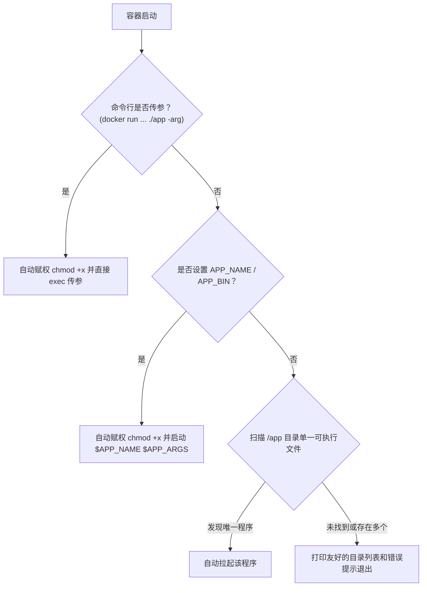

# Go Runner Docker 运行环境

专为运行预编译 Go（Golang）程序打造的轻量、健壮的 Docker 运行时镜像。

## 🌟 特性

- **超轻量**：基于 `alpine:3.21`，整机环境大小仅约 15MB。
- **全要素就绪**：
  - `ca-certificates`：解决 Go 应用发起 HTTPS 外部请求的根证书校验问题。
  - `tzdata`：内置国内时区（默认 `Asia/Shanghai`），解决 Go 中 `time.LoadLocation` 报错与日志时间偏差。
  - `gcompat`：在 Alpine (musl) 环境下提供 glibc 兼容层，避免非纯静态编译产生的 `file not found` 动态链接错误。
  - `tini`：作为容器 PID 1 进程，负责信号无损下发（优雅关机）及自动回收僵死子进程。
- **智能启动器（Launcher）**：
  - 自动修复宿主机挂载文件因权限缺失导致的 `Permission denied`（自动 `chmod +x`）。
  - 支持多层启动策略：命令行直接传参 > 环境变量指定 > 智能探测单文件。
  - 支持启动前钩子（`PRE_RUN_CMD`）。

---

## 🛠️ 第一步：编译 Go 二进制程序

在宿主机上将 Go 源码交叉编译为 Linux 平台可执行的二进制文件：

### Windows (PowerShell)
```powershell
$env:CGO_ENABLED=0; $env:GOOS="linux"; $env:GOARCH="amd64"; go build -trimpath -ldflags="-s -w" -o myapp .
```

### Linux / macOS
```bash
CGO_ENABLED=0 GOOS=linux GOARCH=amd64 go build -trimpath -ldflags="-s -w" -o myapp .
```
> **提示**：即使开启了 CGO（`CGO_ENABLED=1`），由于本镜像预装了 `gcompat`，常见的 glibc 动态二进制也可直接兼容运行。

---

## 🚀 第二步：运行 Go 程序

假设你编译出的二进制为 `myapp`，并且你的配置文件 `config.yaml` 存放在宿主机的 `D:/my-go-project`（或 Linux 的 `/data/my-go-project`）目录下。

### 方式 1：使用 Docker 命令行直接挂载运行（推荐）

```bash
docker run -d \
  --name my-go-service \
  --restart unless-stopped \
  -v D:/my-go-project:/app \
  -e APP_NAME=myapp \
  -e APP_ARGS="-c /app/config.yaml --port 8080" \
  -p 8080:8080 \
  go-runner:latest
```

---

### 方式 2：使用 Docker Compose 运行（推荐搭配 .env）

复制并编辑 `.env.example` 为 `.env`：
```bash
cp .env.example .env
```
根据实际需求修改 `.env` 变量：
```env
CONTAINER_NAME=my-go-app
APP_NAME=myapp
APP_ARGS=-c /app/config.yaml --port 8080
HOST_PORT=8080
CONTAINER_PORT=8080
DATA_DIR=./data
TZ=Asia/Shanghai
```

本项目提供的 `docker-compose.yml` 完全由 `.env` 驱动，无需修改 yaml 即可运行：
```yaml
version: '3.8'

services:
  go-app:
    build:
      context: .
      dockerfile: Dockerfile
    image: go-runner:latest
    container_name: ${CONTAINER_NAME:-my-go-app}
    restart: unless-stopped
    working_dir: /app
    volumes:
      - ${DATA_DIR:-./data}:/app
    environment:
      - APP_NAME=${APP_NAME}
      - APP_ARGS=${APP_ARGS}
      - TZ=${TZ:-Asia/Shanghai}
      - PRE_RUN_CMD=${PRE_RUN_CMD:-}
    ports:
      - "${HOST_PORT}:${CONTAINER_PORT}"
```

启动命令：
```bash
docker compose up -d
```

---

### 方式 3：直接传参启动（覆盖 CMD）

如果你不想配置环境变量，也可以直接在命令末尾指定要执行的程序和参数：

```bash
docker run -d \
  --name my-go-service \
  -v D:/my-go-project:/app \
  -p 8080:8080 \
  go-runner:latest ./myapp -c /app/config.yaml
```

---

### 方式 4：作为基础镜像烘焙（构建独立交付镜像）

如果需要将编译好的程序打包为独立的 Docker 镜像分发给客户或部署到服务器：

```dockerfile
FROM go-runner:latest

# 拷贝本地编译好的程序与配置到 /app
COPY myapp /app/myapp
COPY config.yaml /app/config.yaml

ENV APP_NAME=myapp \
    APP_ARGS="-c /app/config.yaml"

EXPOSE 8080
```

---

## ⚙️ 环境变量说明（`.env`）

| 环境变量 | 默认值 | 作用与示例 |
| :--- | :--- | :--- |
| `CONTAINER_NAME` | `my-go-app` | Docker 容器名称 |
| `APP_NAME` / `APP_BIN` | （空） | 要启动的目标程序文件名，例如 `myapp` 或 `/app/server` |
| `APP_ARGS` | （空） | 传递给目标程序的启动参数，例如 `-c /app/config.yaml --port 8080` |
| `HOST_PORT` | `8080` | 宿主机映射端口 |
| `CONTAINER_PORT` | `8080` | 容器内监听端口 |
| `DATA_DIR` | `./data` | 本地挂载目录路径（存放 Go 二进制和配置） |
| `APP_DIR` | `/app` | 容器内工作目录，默认自动进入该目录 |
| `TZ` | `Asia/Shanghai` | 容器时区设置 |
| `PRE_RUN_CMD` | （空） | 可选：启动主程序之前先执行的 shell 命令 |

---

## 🔍 Launcher 启动逻辑顺序


